# Cognex VisionPro 工具学习笔记

> 适用范围：VisionPro
> 常见定位、边缘检测、几何构造、几何查找/拟合与几何测量工具。\
> 阅读方式：每个工具包含 **工具名称、作用、典型输入、输出**。\
> 注意：这里的"典型输入/输出"描述的是工具的概念级数据，不等同于某个
> VisionPro 版本的完整 API
> 属性清单。具体端口、参数名称和结果类型请以当前安装版本的 Help
> 文档及工具编辑器为准。

## 一、基础定位、边缘检测、标定与坐标定位

### 1. `CogPMAlignTool`

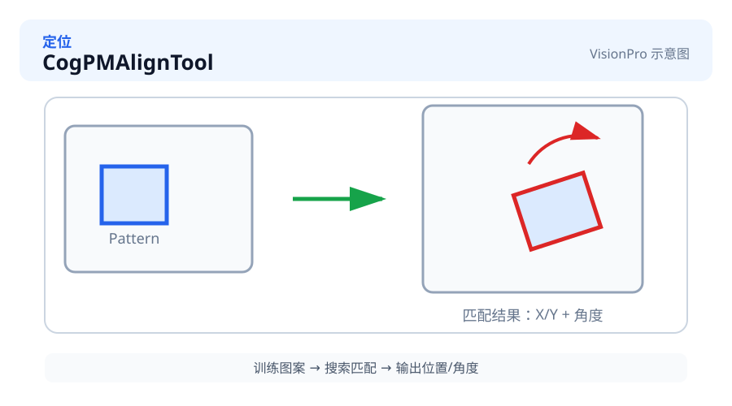

-   **作用**：基于训练好的图案，在运行图像中查找相同或相似的目标，估计目标的位置、旋转角度以及配置支持的缩放变化。常用于工件定位、跟随定位结果进行后续检测。
-   **典型输入**：
    -   运行图像。
    -   预先训练的 Pattern（训练图像及训练区域）。
    -   搜索区域、角度范围、缩放范围、匹配阈值等运行参数。
-   **输出**：
    -   一个或多个匹配结果。
    -   目标的 X/Y
        位置、角度、匹配分数；在相应模式下还可能包含缩放等信息。
    -   可用于下游工具的目标位姿/二维变换（Pose/Transform）。
-   **记忆要点**：先训练，再搜索；常与 `CogFixtureTool`
    配合，让后续工具跟随工件位置和角度。

### 2. `CogCaliperTool`

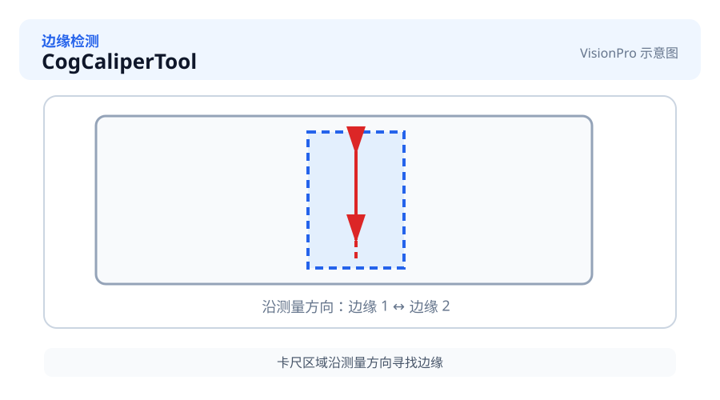

-   **作用**：在指定的卡尺区域内沿测量方向寻找图像边缘，可检测单边缘或按设置检测边缘对。常用于测量边缘位置、宽度、间距和零件尺寸。
-   **典型输入**：
    -   运行图像。
    -   卡尺区域/测量线及搜索范围。
    -   边缘极性（由暗到亮、由亮到暗或不限定）、对比度阈值、边缘选择方式等参数。
-   **输出**：
    -   找到的边缘位置、边缘强度/评分等结果。
    -   若配置为边缘对，可得到两条边缘及其间距/宽度等测量结果。
    -   具体结果集合取决于卡尺设置。
-   **记忆要点**：卡尺是在局部区域沿指定方向找边；如果目标是从整幅图像中拟合长直线，可进一步了解
    `CogFindLineTool`。

### 3. `CogCalibCheckerboardTool`

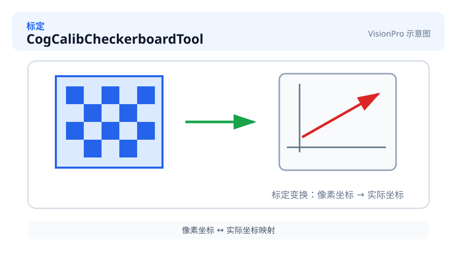

-   **作用**：利用棋盘格或受支持的点阵标定板建立图像坐标与标定坐标之间的映射；可按配置进行透视/径向畸变校正。
-   **典型输入**：
    -   标定板图像。
    -   标定板类型、网格/点间距等已知物理尺寸。
    -   标定方式与计算模式等参数。
    -   使用时通常需要先执行标定步骤，再运行工具。
-   **输出**：
    -   携带标定坐标空间的输出图像。
    -   标定变换/坐标映射信息。
    -   在相应计算模式下输出经过校正或重映射的图像。
-   **记忆要点**：标定的核心是建立"像素坐标 ↔
    实际坐标"的关系；标定板尺寸必须准确，标定图像也应符合工具要求。

### 4. `CogFixtureTool`

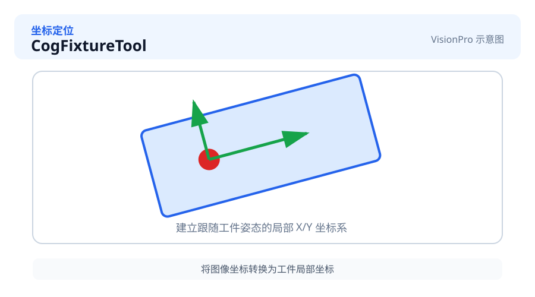

-   **作用**：在输入图像的坐标树中附加一个局部坐标系，使后续工具可以相对于工件或基准特征进行检测，而不必始终使用图像的固定坐标。
-   **典型输入**：
    -   输入图像。
    -   用于定义局部坐标系的基准位置/方向或二维变换，通常可来自上游定位工具。
    -   Fixture 相关参数。
-   **输出**：
    -   带有新局部坐标空间的输出图像。
    -   更新后的坐标树/坐标变换，供下游工具使用。
-   **记忆要点**：Fixture
    通常不负责寻找工件，而是把已有的定位结果用于建立局部坐标系；它与相机标定不是同一件事。

------------------------------------------------------------------------

## 二、Geometry - Creation（几何创建）

> 这组工具的主要任务是**根据已有几何数据或数值参数构造几何对象**，通常不是直接从图像中识别特征。

### 5. `CogCreateCircleTool`

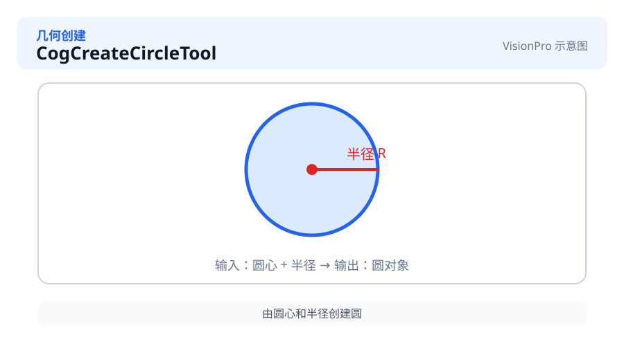

-   **作用**：创建圆形几何对象。
-   **典型输入**：圆心坐标与半径，或工具所支持的等价圆参数。
-   **输出**：圆对象，通常包含圆心、半径及相关几何信息。
-   **典型用途**：创建理论圆、构造检测基准、参与后续距离计算。

### 6. `CogCreateEllipseTool`

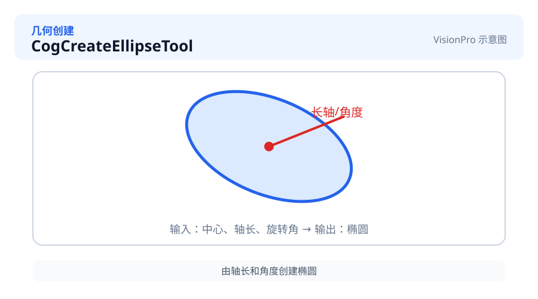

-   **作用**：创建椭圆几何对象。
-   **典型输入**：椭圆中心、长短轴尺寸/半轴、旋转角度等参数。
-   **输出**：椭圆对象，包含中心、轴长和方向等几何信息。
-   **典型用途**：建立理论椭圆，或作为后续几何测量的输入。

### 7. `CogCreateGraphicLabelTool`

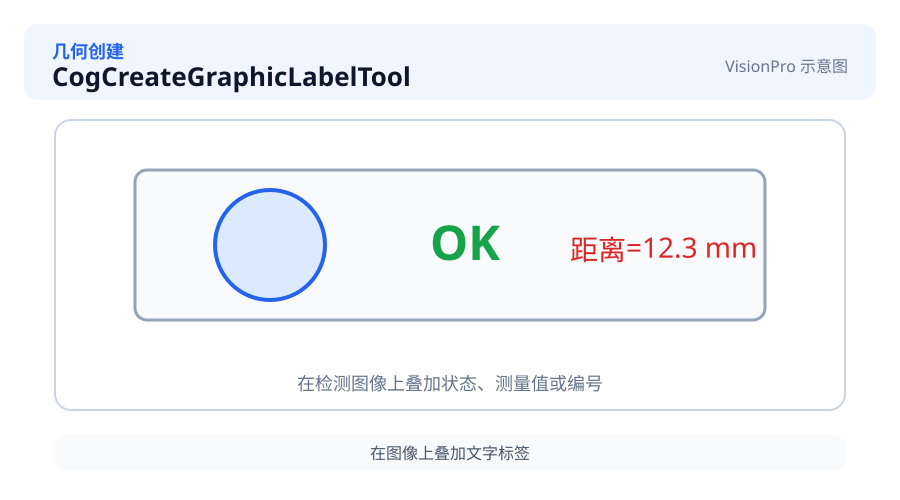

-   **作用**：创建用于图像显示界面的图形文字标签。
-   **典型输入**：文本内容、显示位置、字体/字号、颜色及对齐方式等显示参数。
-   **输出**：图形标签对象，供显示界面叠加显示。
-   **典型用途**：在检测画面中显示 OK/NG、测量值、工件编号等。
-   **注意**：图形叠加对象通常用于可视化，并不等于把文字像素永久写入原始图像。

### 8. `CogCreateLineBisectPointTool`

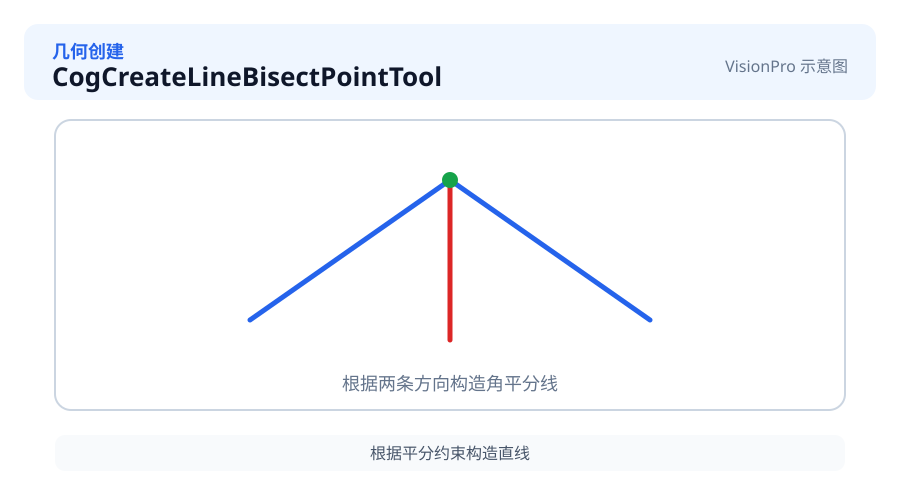

-   **作用**：根据工具设定的平分点/角平分几何约束构造直线，常用于构造角平分方向或相关基准线。
-   **典型输入**：定义平分关系的点、线或其他几何约束；实际需要的输入以当前版本工具编辑器为准。
-   **输出**：构造出的直线几何对象。
-   **典型用途**：根据已有几何关系建立辅助线，供后续角度或距离测量使用。
-   **注意**：该工具名称对应的具体几何约束应以本机 VisionPro
    版本的参数说明为准，不要仅凭名称推断端口顺序。

### 9. `CogCreateLineParallelTool`

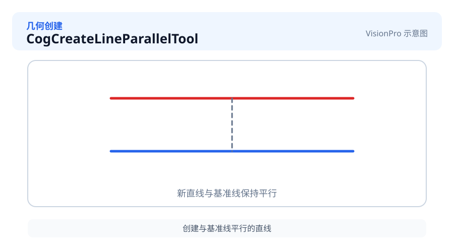

-   **作用**：创建一条与参考直线平行的直线。
-   **典型输入**：参考直线，以及用于确定新直线位置的点或偏移等约束。
-   **输出**：新建的直线对象。
-   **典型用途**：创建平行基准线、构造工件边缘的平行检测线。

### 10. `CogCreateLinePerpendicularTool`

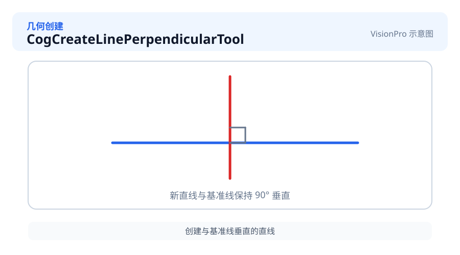

-   **作用**：创建一条与参考直线垂直的直线。
-   **典型输入**：参考直线，以及用于确定新直线位置的点或偏移等约束。
-   **输出**：新建的直线对象。
-   **典型用途**：构造垂直基准、建立点到线距离的辅助几何关系。

### 11. `CogCreateLineTool`

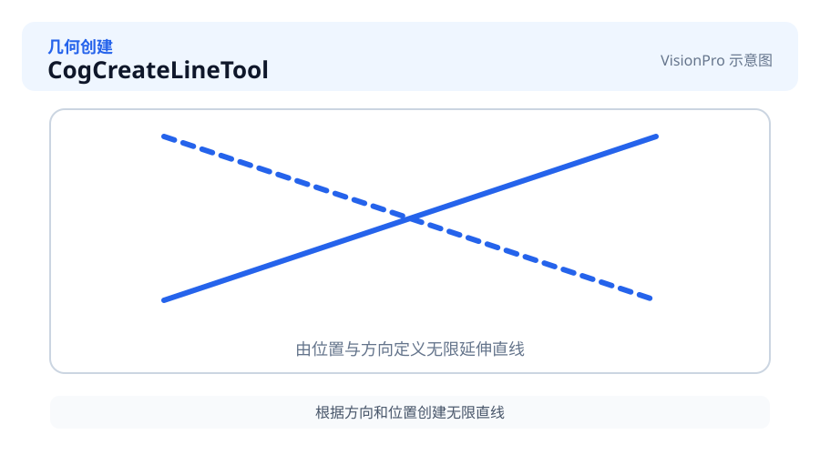

-   **作用**：根据输入的点、方向或线参数创建直线。
-   **典型输入**：工具支持的直线定义参数，例如点与方向、斜率/角度或其他几何约束。
-   **输出**：直线对象，通常可用于后续几何计算。
-   **典型用途**：由检测到的点构造理论直线，或建立测量基准。

### 12. `CogCreateSegmentAvgSegsTool`

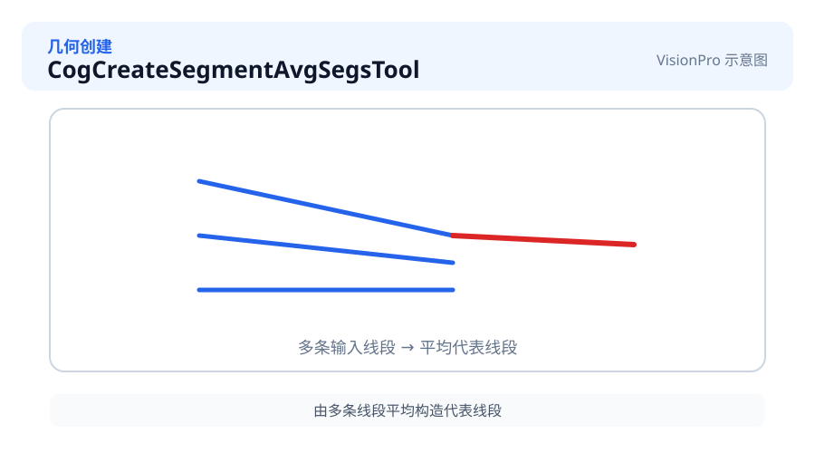

-   **作用**：根据多条输入线段计算/构造代表它们平均几何特征的线段。
-   **典型输入**：多条线段及工具要求的平均/组合方式。
-   **输出**：平均线段或代表性线段对象。
-   **典型用途**：把多条相近线段归并成一个代表结果，降低单个结果波动对后续计算的影响。
-   **注意**：平均的具体规则受工具实现和输入几何关系影响；使用前应检查当前版本的参数定义。

### 13. `CogCreateSegmentTool`

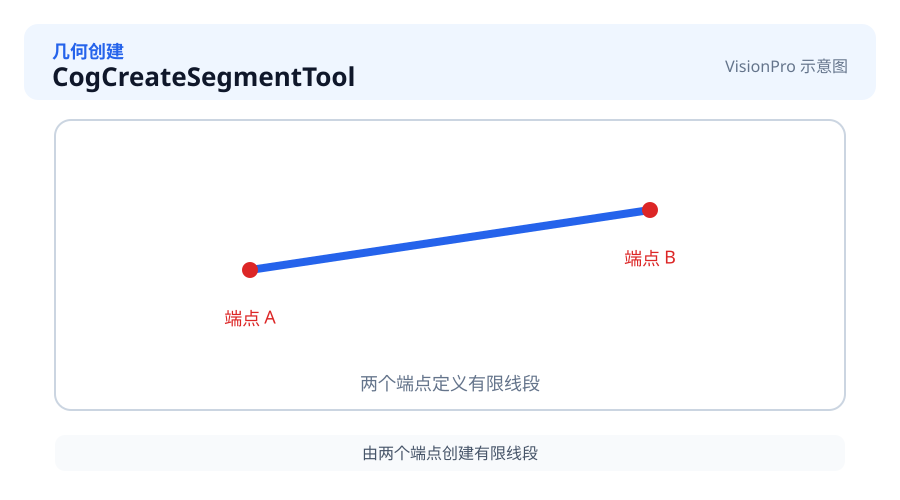

-   **作用**：创建有限长度的线段。
-   **典型输入**：起点与终点，或工具支持的线段位置、方向和长度等参数。
-   **输出**：线段对象，包含两个端点及长度、方向等可计算信息。
-   **典型用途**：建立有限测量区间，区别于理论上无限延伸的直线。

------------------------------------------------------------------------

## 三、Geometry - Finding & Fitting（几何查找与拟合）

> **Find** 通常侧重于从图像中检测/定位几何特征；**Fit**
> 通常侧重于用已有点或几何采样数据拟合出一个理想几何对象。实际工具的输入形式仍需以具体版本为准。

### 14. `CogFindCircleTool`

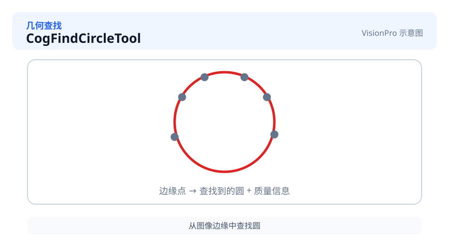

-   **作用**：在图像的指定区域中查找圆形边缘或圆形特征。
-   **典型输入**：图像、搜索区域、预期圆心/半径范围、边缘和查找参数。
-   **输出**：检测到的圆几何结果，如圆心、半径、查找质量/评分及相关状态。
-   **典型用途**：定位孔、圆形零件、轴套或圆形标记。

### 15. `CogFindCornerTool`

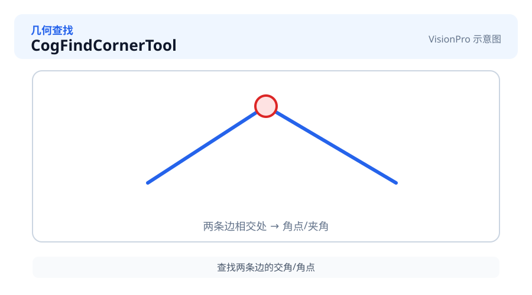

-   **作用**：在图像中查找由边缘形成的角点/拐角。
-   **典型输入**：图像、搜索区域、边缘方向/极性及角点搜索参数。
-   **输出**：角点位置；视工具设置，还可能包含角度、相关边缘或质量信息。
-   **典型用途**：定位矩形工件的角、板材拐角或两条边的交会位置。

### 16. `CogFindEllipseTool`

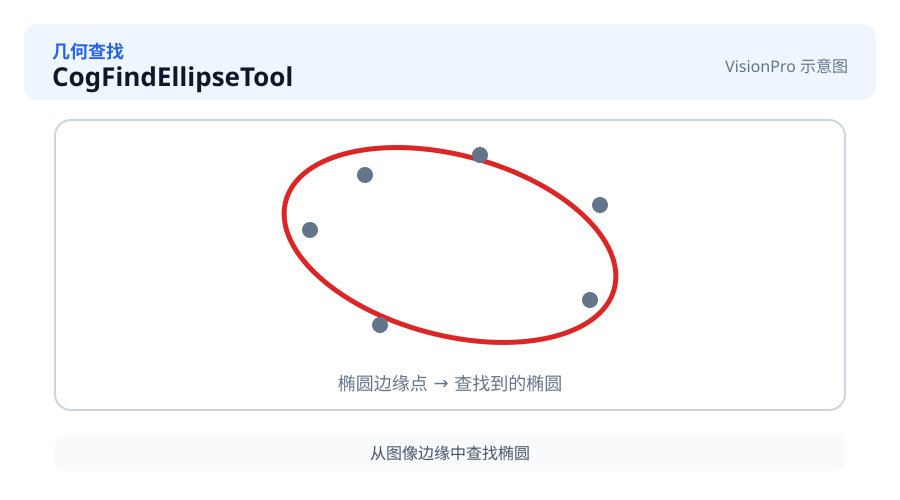

-   **作用**：在图像区域中查找椭圆形边缘或椭圆特征。
-   **典型输入**：图像、搜索区域、预期中心/轴长/方向范围及边缘查找参数。
-   **输出**：椭圆几何结果，如中心、长短轴、旋转角和相关质量信息。
-   **典型用途**：检测倾斜圆孔、椭圆轮廓或投影后呈椭圆形的特征。

### 17. `CogFindLineTool`

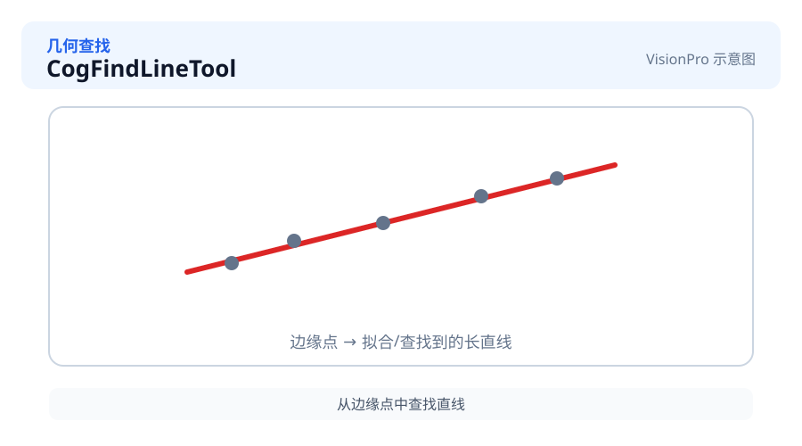

-   **作用**：在图像中沿指定搜索区域查找直线边缘。
-   **典型输入**：图像、线形搜索区域、搜索方向、边缘极性/阈值等参数。
-   **输出**：找到的直线或线结果，以及相关位置、方向和质量信息。
-   **典型用途**：检测工件边缘、槽边、板材边线等。

### 18. `CogFitCircleTool`

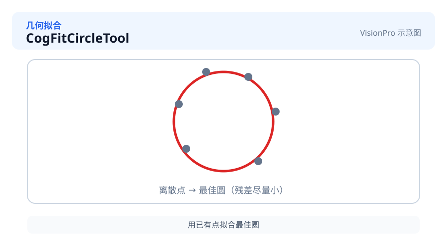

-   **作用**：根据输入的点或边缘采样数据拟合一个圆。
-   **典型输入**：点集合/圆弧采样点或工具支持的几何数据，以及拟合方式和约束。
-   **输出**：拟合圆的圆心、半径，以及拟合残差或质量信息（视工具设置而定）。
-   **典型用途**：将多个边缘点拟合为稳定的圆，评估孔径或圆度相关几何特征。
-   **与 Find 的区别**：Fit 的重点是拟合输入数据；Find
    的重点是从图像区域中查找特征。

### 19. `CogFitEllipseTool`

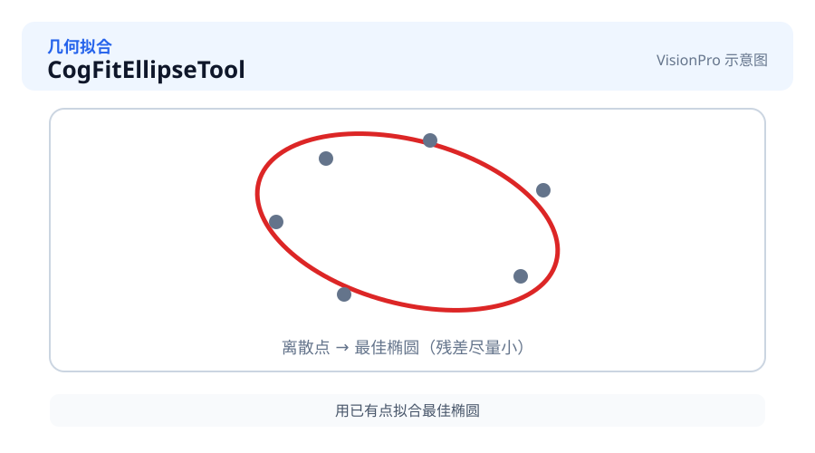

-   **作用**：根据点或边缘采样数据拟合椭圆。
-   **典型输入**：点集合/轮廓采样点，以及拟合参数。
-   **输出**：椭圆中心、长短轴、方向及拟合质量信息。
-   **典型用途**：用一组轮廓点求出最符合数据的椭圆。

### 20. `CogFitLineTool`

-   **作用**：根据点、线段或其他支持的几何数据拟合直线。
-   **典型输入**：点集合/边缘点或工具支持的线性数据，以及拟合方式和约束。
-   **输出**：拟合直线的位置、方向及拟合质量/残差信息。
-   **典型用途**：用多个采样点求出稳定的基准线，减弱个别点偏差的影响。

### 21. `CogMultiLineFinderTool`

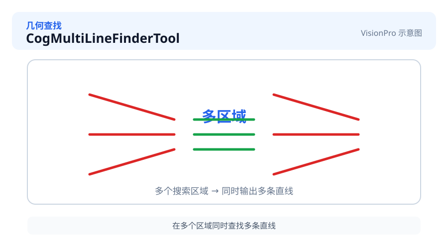

-   **作用**：在图像的指定区域中查找多条直线或多组线特征。
-   **典型输入**：图像、搜索区域、线条数量/方向范围及边缘搜索参数。
-   **输出**：多条线的结果集合，通常包含各线的位置、方向及相关质量信息。
-   **典型用途**：检测多条平行线、栅格、多个槽边或重复线性结构。
-   **注意**：实际可检测的线条数量和结果形式取决于搜索参数与图像质量。

------------------------------------------------------------------------

## 四、Geometry - Measurement（几何测量）

> 测量工具通常接收已创建、查找到或拟合得到的几何对象。要特别区分"两个对象中心之间的距离"和"两个几何轮廓之间的最短距离"；不同测量任务应选择对应的几何定义。

### 22. `CogAngleLineLineTool`

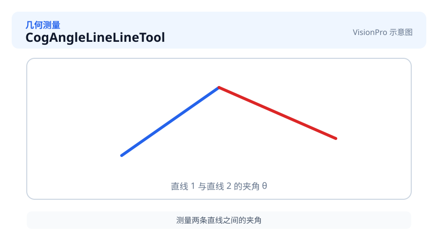

-   **作用**：计算两条直线之间的夹角。
-   **典型输入**：直线 A、直线 B。
-   **输出**：角度测量值；具体是有向角、无向角或角度范围由工具配置/定义决定。
-   **典型用途**：测量工件夹角、两条边的平行度趋势或装配角度。

### 23. `CogAnglePointPointTool`

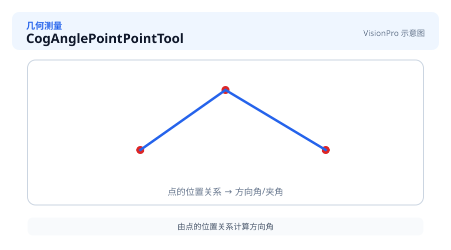

-   **作用**：根据工具定义的点及其方向关系计算角度/方向角。
-   **典型输入**：点相关几何数据及工具要求的参考点、参考方向或坐标系。
-   **输出**：角度值。
-   **典型用途**：从点的位置关系得到方向角或角度测量结果。
-   **注意**：点与点本身只能确定一条方向；如果目标明确是"两条直线之间的夹角"，优先检查是否应使用
    `CogAngleLineLineTool`。请按当前版本的工具输入说明确认所需点的数量和角度定义。

### 24. `CogDistanceCircleCircleTool`

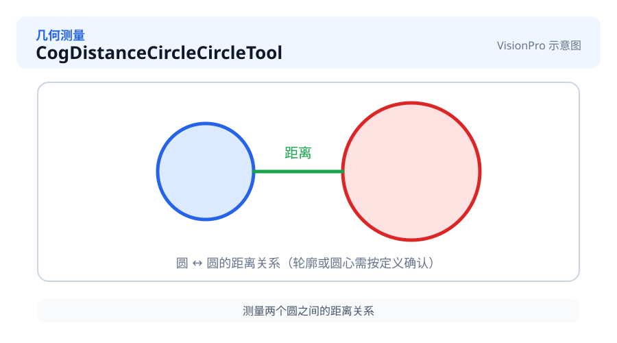

-   **作用**：计算两个圆几何对象之间的距离关系。
-   **典型输入**：圆 A、圆 B。
-   **输出**：工具定义的圆间距离结果。
-   **典型用途**：测量两个圆形特征之间的间距。
-   **注意**：如果需求是圆心距，应明确使用圆心点之间的距离；不要默认轮廓间距与圆心距相同。

### 25. `CogDistanceLineCircleTool`

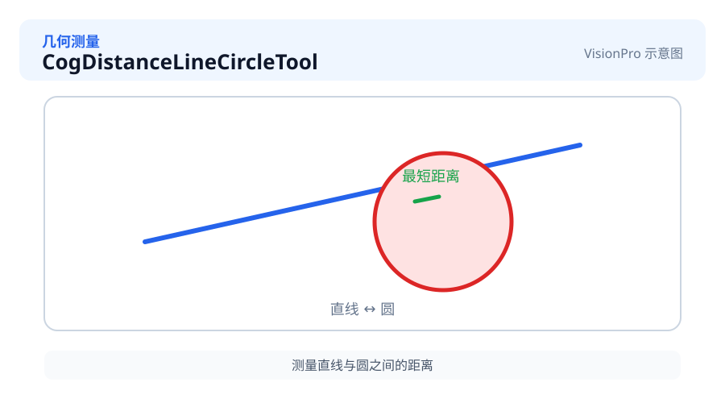

-   **作用**：计算直线与圆之间的距离关系。
-   **典型输入**：直线、圆。
-   **输出**：工具定义的线---圆距离结果。
-   **典型用途**：测量圆形特征相对某条基准边的位置关系。
-   **注意**：应结合工具定义确认结果表示最近距离、带符号距离还是其他距离约定。

### 26. `CogDistanceLineEllipseTool`

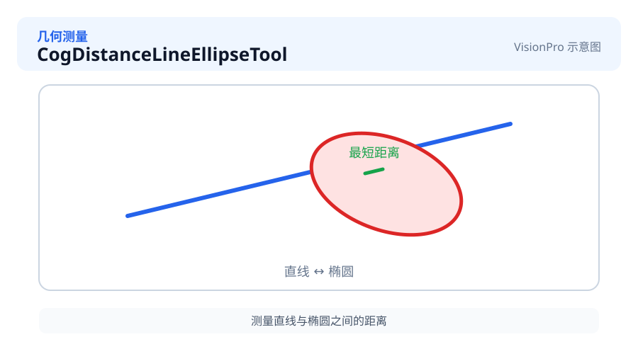

-   **作用**：计算直线与椭圆之间的距离关系。
-   **典型输入**：直线、椭圆。
-   **输出**：工具定义的线---椭圆距离结果。
-   **典型用途**：测量椭圆孔/轮廓相对基准线的位置。

### 27. `CogDistancePointCircleTool`

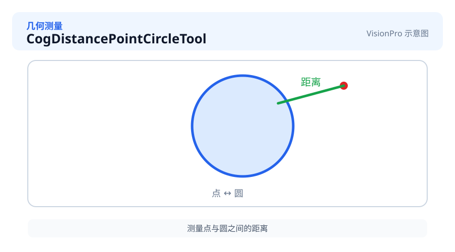

-   **作用**：计算点与圆之间的距离关系。
-   **典型输入**：点、圆。
-   **输出**：点---圆距离结果。
-   **典型用途**：测量某个特征点到圆形轮廓或圆形几何基准的距离。
-   **注意**：若需要点到圆心的距离，应把圆心作为点，使用点---点距离。

### 28. `CogDistancePointEllipseTool`

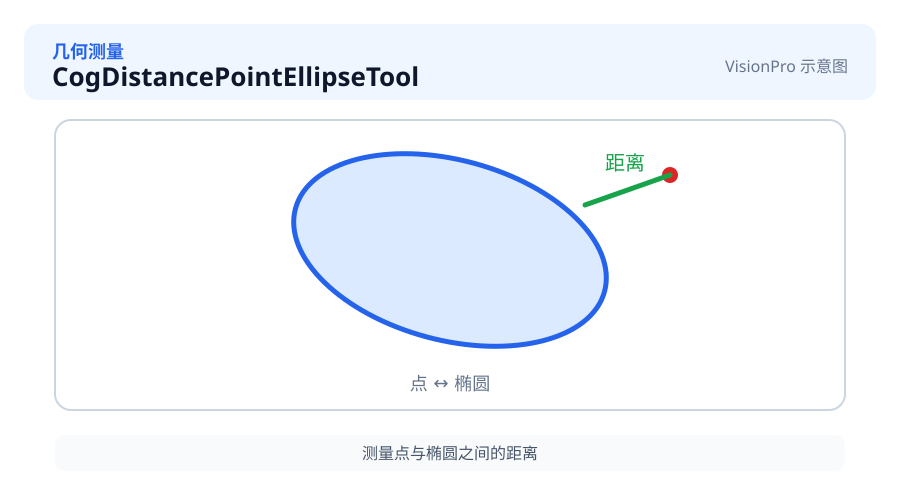

-   **作用**：计算点与椭圆之间的距离关系。
-   **典型输入**：点、椭圆。
-   **输出**：点---椭圆距离结果。
-   **典型用途**：测量点相对椭圆轮廓的位置或间距。

### 29. `CogDistancePointLineTool`

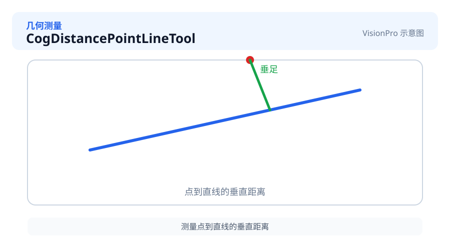

-   **作用**：计算点到直线的距离，常见几何意义是点到直线的垂直距离。
-   **典型输入**：点、直线。
-   **输出**：距离值；具体符号约定取决于工具配置。
-   **典型用途**：测量边缘点偏离基准线的程度、测量位置偏差。

### 30. `CogDistancePointPointTool`

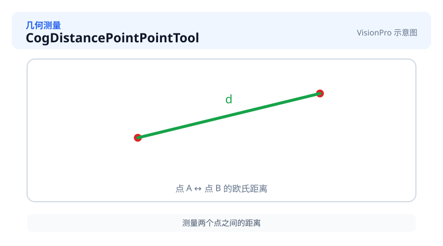

-   **作用**：计算两个点之间的距离。
-   **典型输入**：点 A、点 B。
-   **输出**：点间距离，通常为欧氏距离。
-   **典型用途**：测量孔中心距、两个定位点间距或特征点位移。

### 31. `CogDistancePointSegmentTool`

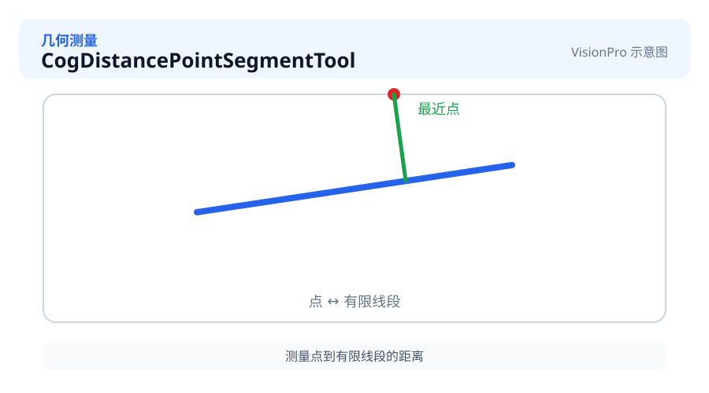

-   **作用**：计算点与有限线段之间的距离。
-   **典型输入**：点、线段。
-   **输出**：点---线段距离。
-   **典型用途**：测量某个点到有限边缘的距离。
-   **与 PointLine
    的区别**：直线无限延伸；线段只有起点和终点，最近位置可能落在线段内部，也可能落在端点。

### 32. `CogDistanceSegmentCircleTool`

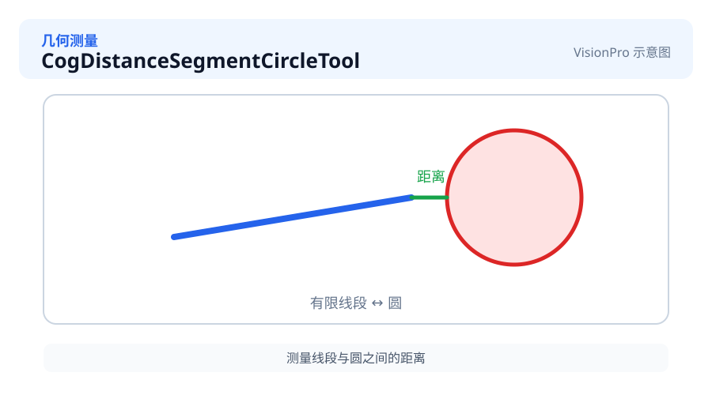

-   **作用**：计算有限线段与圆之间的距离关系。
-   **典型输入**：线段、圆。
-   **输出**：工具定义的线段---圆距离结果。
-   **典型用途**：测量一段有限边缘与圆形特征之间的间距。

### 33. `CogDistanceSegmentEllipseTool`

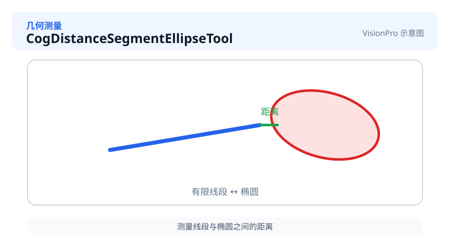

-   **作用**：计算有限线段与椭圆之间的距离关系。
-   **典型输入**：线段、椭圆。
-   **输出**：工具定义的线段---椭圆距离结果。
-   **典型用途**：测量有限边缘与椭圆孔/轮廓之间的间距。

### 34. `CogDistanceSegmentLineTool`

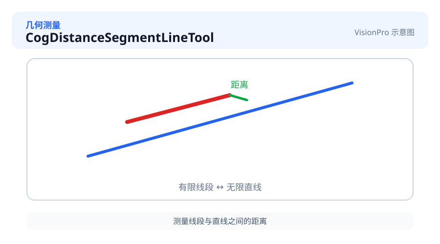

-   **作用**：计算有限线段与直线之间的距离关系。
-   **典型输入**：线段、直线。
-   **输出**：工具定义的线段---直线距离结果。
-   **典型用途**：测量一段边缘与无限延伸的基准线之间的位置关系。

### 35. `CogDistanceSegmentSegmentTool`

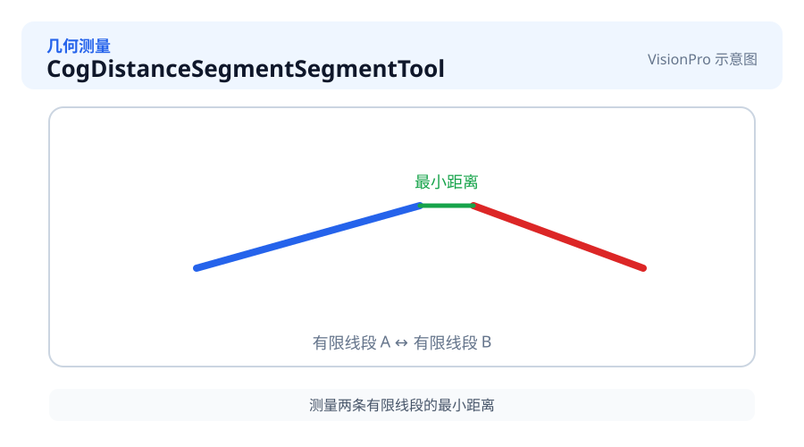

-   **作用**：计算两条有限线段之间的距离关系。
-   **典型输入**：线段 A、线段 B。
-   **输出**：线段---线段距离。
-   **典型用途**：测量两段边缘之间的间隙或最小距离。
-   **注意**：若线段相交或延长线相交，结果与两条无限直线之间的距离可能不同。

------------------------------------------------------------------------

## 五、快速对照表

  ----------------------------------------------------------------------------------------------------------------------
  工具类别          代表工具                              主要任务                    常见输出
  ----------------- ------------------------------------- --------------------------- ----------------------------------
  定位              `CogPMAlignTool`                      在图像中找训练图案          位置、角度、分数、位姿/变换

  边缘检测          `CogCaliperTool`                      在局部卡尺区域找边缘        边缘位置、评分、边缘间距

  标定              `CogCalibCheckerboardTool`            建立标定坐标映射/校正图像   标定信息、标定坐标空间、输出图像

  坐标定位          `CogFixtureTool`                      建立局部坐标系              带新坐标空间的图像

  几何创建          `CogCreate*Tool`                      根据参数/几何约束构造对象   点、线、线段、圆、椭圆、标签等

  几何查找          `CogFind*Tool`                        从图像中查找特征            检测到的几何对象及质量信息

  几何拟合          `CogFit*Tool`                         根据已有数据拟合几何对象    拟合对象及拟合质量信息

  几何测量          `CogAngle*Tool`、`CogDistance*Tool`   计算角度或距离              角度值、距离值
  ----------------------------------------------------------------------------------------------------------------------

## 七、官方参考资料

-   Cognex VisionPro
    官方产品与文档入口：<https://support.cognex.com/en/products/visionpro>
-   Cognex 官方"Calibration and
    Fixturing"说明：<https://docs.cognex.com/vpro_0x091400/web/EN/help/html/84936534-b095-495b-86f7-f057e51d3af1.htm>
-   Cognex 官方"Understanding Tools and
    Operators"说明：<https://docs.cognex.com/vpro_0x091400/web/EN/help/html/cf59bc04-b1d0-4db3-b0da-66513e3c6996.htm>

> 最终以你安装的 VisionPro
> 版本为准。尤其是几何创建工具的约束参数、测量工具的距离定义，以及工具结果对象的具体类型，建议在
> VisionPro Help 中按完整类名逐项核对。
